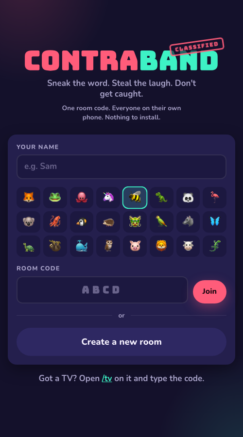
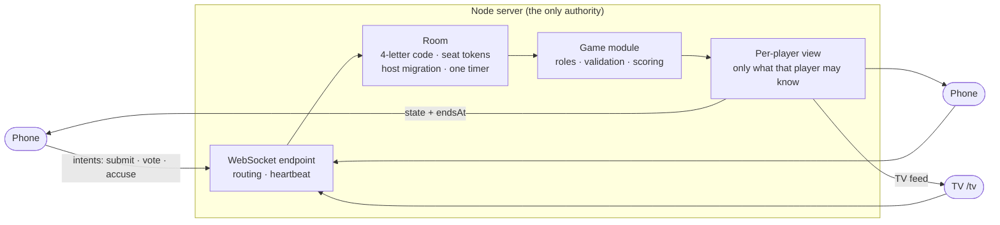

# Contraband

A room-code party game for 3 to 12 phones: sneak the word, steal the laugh, don't get caught.

[](https://github.com/samarthpaliwal/Coding_Game_Project/actions/workflows/ci.yml)
[](LICENSE)


<p align="center">
  
</p>

> Everyone answers the same ridiculous prompt. A secret few are **smugglers** whose answer must hide an
> assigned word. Vote for the funniest answer, then accuse the smugglers. Laughs and getaways both score.

Everyone plays on their own phone. Nobody installs anything and nobody logs in: one person creates a room,
everyone else types the four-letter code or scans the QR.

## Problem

Phone party games break in three ways players notice. A refresh or a locked screen throws someone out of
the game. A secret meant for one player reaches another phone, where anyone curious can find it. And the
big reveal lands a beat apart on each screen, so the room never reacts together.

## Approach



- **The server is the only authority.** Phones send intents (`submit`, `vote`, `accuse`, `lock`, `guess`,
  `wiretap`); the server validates and sends each player a view containing only what that player may know.
  Roles, words, drafts and votes never reach other phones before the reveal, and a unit test asserts it.
- **Refresh-proof seats.** A seat token in `localStorage` re-attaches a player to the same seat with their
  draft, role, vote and wiretap intact. Disconnected players never block a phase; missed inputs get fillers.
- **Timers live on the server.** Clients render countdowns from `endsAt` using a clock offset measured with
  a ping burst, so reveal flips land on every screen in the same beat.
- **No build step, no framework, one dependency** (`ws`). It deploys anywhere Node runs.

Design notes: [docs/DESIGN.md](docs/DESIGN.md).

## Results

- 27 unit tests pass (`npm test`): rules, scoring, the secrecy leak test, room hardening (seat recovery,
  host commands, the 12-player cap) and full games played over real WebSockets.
- An end-to-end suite drives three phones and a TV through a whole game in headless Chromium, plus a
  ten-phone layout and refresh test.
- 340 prompts and 450 contraband words in three tiers. A game takes about 15 minutes with 6 players.

## Quick start

Requires Node.js 20 or newer to run the server, and 22 or newer to run the tests (`npm test` uses a glob that `node --test` only expands from Node 21).

```bash
git clone https://github.com/samarthpaliwal/Coding_Game_Project.git
cd Coding_Game_Project
npm install
npm start
```

Open http://localhost:3000. To play, open the same address on phones on the same Wi-Fi using your
computer's LAN IP instead of `localhost`, and open `/tv` on a laptop or TV to mirror the room.

```bash
npm test
```

The end-to-end tests (`npm run test:e2e`) need Playwright with Chromium, and currently import it from a
fixed path (`/opt/node22/lib/node_modules/playwright`, see `test/e2e/lib.js`), so they only run where
Playwright is installed there. Screenshots go to `test/e2e/artifacts/`.

## How a night goes

1. **Brief.** Every phone flips a card: green *YOU'RE CLEAN*, or red *SMUGGLER — contraband: LASAGNA*. Round 1 tells you exactly how many smugglers there are. Later rounds only give a range ("between 0 and 3 of you"), and from round 3 there might be none at all.
2. **Write** (60 s). Answer the prompt in up to 70 characters. Smugglers cannot submit until the word is in there. Prompts often name someone in the room ("The text Priya would send at 3 a.m."); that person's vote counts double.
3. **Wiretap.** Once per round, if you have a token, watch another player's draft appear letter by letter. Their phone screams *SOMEONE IS TAPPING YOUR LINE* but never says who. Last place gets a fresh token every round.
4. **Vote.** Answers go up anonymously. Tap the funniest. +100 per vote you receive (+200 in the final).
5. **Accuse.** Names come out. Tap up to N suspects, or *NOBODY*. Heat bars race live on every phone as the room turns on someone. +100 per correct pick, −50 per wrong one, +100 bonus for a clean sweep.
6. **Reveal.** Cards flip in sync on every phone and the TV: CLEAN or BUSTED, and the hidden word ignites inside the answer you already laughed at. Getting away clean is +250, untouched by anyone is +350.
7. **Final round: EVERYONE'S DIRTY.** The prompt is built from the night's funniest answer. Everyone smuggles. You score by guessing which word each friend hid, and by fooling them with yours.
8. **Podium and awards.** Crowd Favorite, Ghost, Bloodhound, Most Fooled, Master of Disguise, and the Word of the Night. Copy the recap to the group chat. *Play again* never repeats a prompt or a word.

About 15 minutes at 6 players. Best with 5–8.

## Deploy

[](https://render.com/deploy?repo=https://github.com/samarthpaliwal/Coding_Game_Project)
[](https://app.koyeb.com/deploy?type=git&repository=github.com/samarthpaliwal/Coding_Game_Project&branch=main&name=contraband&builder=dockerfile&ports=3000;http;/)

Any host that runs a Node server with WebSockets works. Memory is the only state, so a redeploy ends live rooms (fine for a party game; say so to your friends).

**Render** (free plan, sleeps when idle, wakes in ~30 s): click the *Deploy to Render* button below, sign in with GitHub, accept the blueprint in `render.yaml`. Your URL will be `https://contraband-xxxx.onrender.com`.

**Koyeb** (free plan): click *Deploy to Koyeb*. It builds the `Dockerfile` and exposes port 3000.

**Anything with Docker** (Railway, Fly.io, Cloud Run, a $4 VPS):

```bash
docker build -t contraband .
docker run -p 3000:3000 contraband
```

The server reads `PORT` from the environment and answers `GET /healthz` for health checks.

## Tech stack

Node.js, WebSockets (`ws`), vanilla JavaScript, HTML and CSS, Docker. Tests use the Node test runner and Playwright.

## Project structure

```
server/
  index.js              HTTP static server, WebSocket endpoint, message routing, heartbeat
  room.js               rooms, seat tokens, host migration, spectators, timers, per-player views, TV feeds
  games/contraband.js   the rules: roles, word tiers, validation, scoring, awards, secrecy
  games/phases.js       timed phases with early advance when everyone is done
  content/              prompts, contraband words in three tiers, reveal stamps, fillers
public/
  js/app.js             phone app: home, lobby (QR and invite link), game screens, podium
  js/games/contraband.js  every phase screen for phones and TV, server-timed reveal choreography
  js/net.js             WebSocket with auto-reconnect and a clock-offset estimate
  js/tv.js              big-screen page: code and QR, roll call, heat grid, podium
test/
  unit/                 rules, room and hardening tests (Node test runner)
  e2e/                  headless Chromium games
docs/                   design notes and screenshots
```

## Adding another game

The room layer is game-agnostic. A game is a module in `server/games/` exporting `{ id, name, minPlayers, maxPlayers, settingsSchema, init, start, action, view, tvView }`, registered in `server/games/index.js`, plus a renderer in `public/js/games/`. With more than one game registered, the lobby shows a game picker.

## Credits

Built with Claude Code. QR codes by [qrcode-generator](https://github.com/kazuhikoarase/qrcode-generator) (MIT). Fonts: Bungee and Nunito via Google Fonts.
